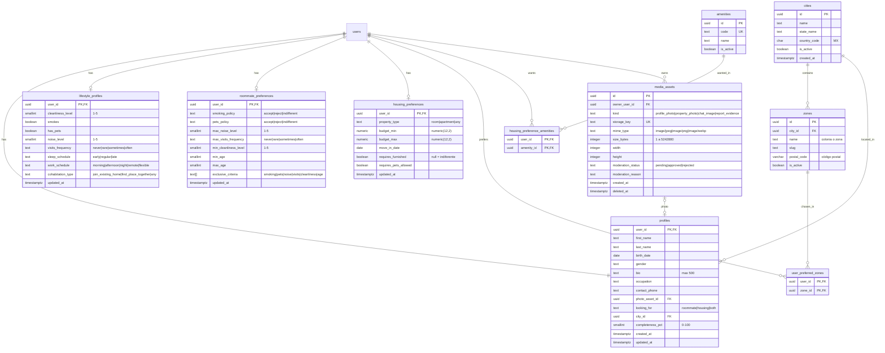
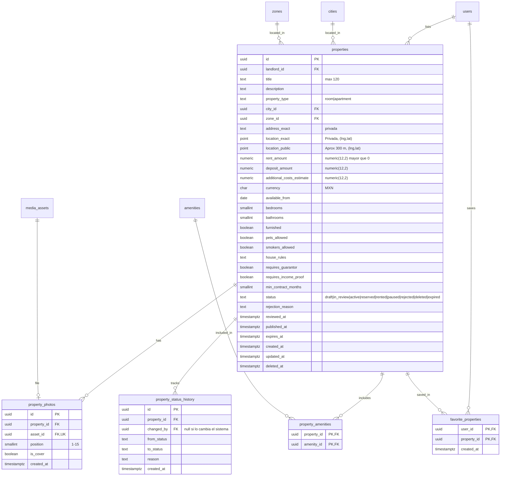
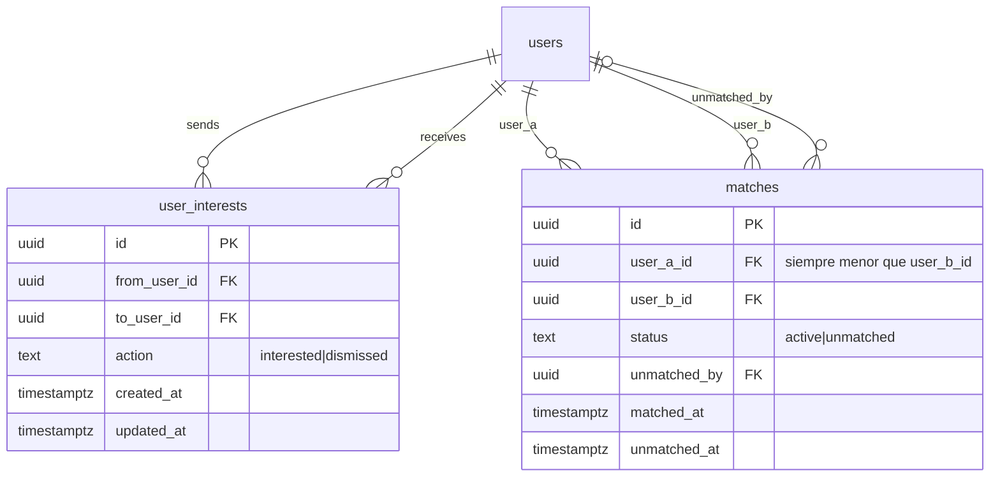
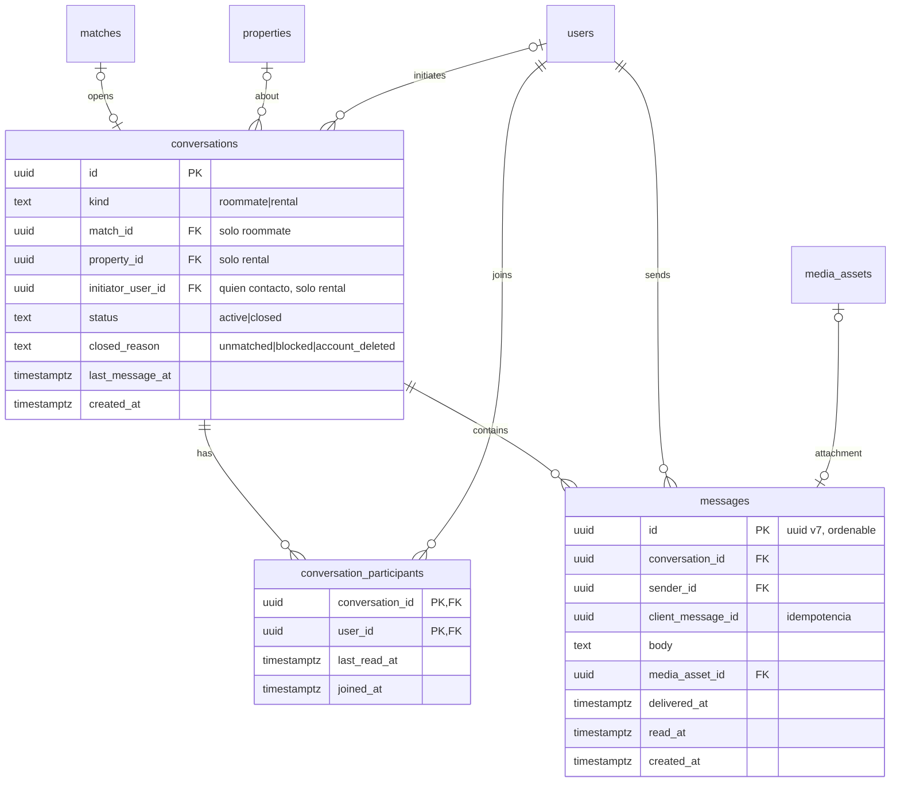
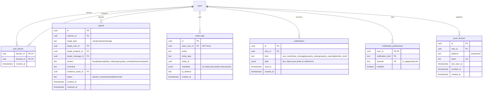

# MatchRoom — Backend Schema (PostgreSQL + NestJS)

**Versión:** 1.2 — MVP (alineada con la implementación TypeORM del repositorio)
**Fecha:** 5 de noviembre de 2026
**Fuentes:** `matchroom_requerimientos_consolidados.md` v1.1 y `matchroom_database_entities_mvp_v1_1.md` (fuente de verdad de tablas y columnas).
**Alcance:** 34 tablas del MVP. La compatibilidad **no** tiene tablas propias: se calcula en un servicio (sección 7). Las funciones de Fase 2 y Futuro se documentan como extensiones (sección 15) y no se implementan.
**Nota de implementación:** los módulos NestJS, los nombres de servicios y el tipo geográfico (`point` nativo en lugar de `geography`) reflejan el código actual en `src/`. PostGIS queda como mejora opcional.

**Cómo usar este documento:** los diagramas (secciones 3 a 10) definen entidades, columnas y relaciones; las secciones 11 y 12 definen las reglas de comportamiento que los servicios de NestJS deben cumplir. Si algo contradice a `matchroom_database_entities_mvp_v1_1.md` en tablas o columnas, prevalece ese documento.

---

## 1. Convenciones

| Tema | Decisión |
|---|---|
| Motor | PostgreSQL 15 o superior, con extensión `citext`. `gen_random_uuid()` es nativo. |
| Claves primarias | `id uuid` con default `gen_random_uuid()`; la aplicación puede enviar UUID v7. Usar UUID v7 donde el orden temporal ayude a paginar, sobre todo en `messages`. |
| Tablas especiales | Las tablas 1:1 con `users` usan `user_id` como PK. Las tablas de unión usan PK compuesta. |
| Nombres | `snake_case`, tablas en plural, FKs como `<entidad>_id`. |
| Fechas | `timestamptz` en UTC. Fechas sin hora (`birth_date`, `available_from`, `move_in_date`) como `date`. |
| `created_at` / `updated_at` | `timestamptz NOT NULL DEFAULT now()`. `updated_at` solo donde aparece; la aplicación o el ORM lo actualiza al modificar la fila. |
| Dinero | `numeric(12,2)`, nunca `float`. Moneda por defecto `MXN` (`char(3)`). |
| Enums | Columna `text` + `CHECK (col IN (...))`; sin tipos enum nativos. Valores en la sección 13. |
| `ON DELETE` | `RESTRICT` por defecto; `CASCADE` o `SET NULL` donde se indica. |
| Migraciones | Versionadas; nunca `synchronize: true`. Los `CHECK`, índices parciales y columnas geográficas se escriben en SQL dentro de la migración si el ORM no los soporta. |
| Archivos | Los binarios viven fuera de PostgreSQL (almacenamiento de objetos). La BD guarda solo metadatos en `media_assets`. |
| Ubicación | `location_exact` y `location_public` usan el tipo nativo `point` de PostgreSQL, almacenado como `(longitud, latitud)`. La pública se calcula **al guardar** el anuncio con un desplazamiento aproximado (~300 m). PostGIS es opcional. |
| Columnas sensibles | `password_hash`, `refresh_token_hash`, `token_hash`, `provider_reference`, `address_exact` y `location_exact` se marcan con `select: false` en TypeORM y nunca salen por HTTP. |

### Mapa de módulos NestJS → entidades

| Módulo NestJS | Entidades |
|---|---|
| `AccountsModule` | `users`, `auth_identities`, `user_sessions`, `one_time_tokens`, `legal_acceptances` |
| `CatalogModule` | `cities`, `zones`, `amenities` |
| `MediaModule` | `media_assets` |
| `ProfilesModule` | `profiles`, `lifestyle_profiles`, `roommate_preferences`, `housing_preferences`, `user_preferred_zones`, `housing_preference_amenities` |
| `PrivacyModule` | `privacy_settings`, `privacy_requests`, `identity_verifications` |
| `PropertiesModule` | `properties`, `property_photos`, `property_amenities`, `property_status_history`, `favorite_properties` |
| `CompatibilityModule` | Sin tablas. `CompatibilityService` lee perfiles, preferencias y propiedades. |
| `MatchingModule` | `user_interests`, `matches` |
| `ChatModule` (+ WebSocket gateway) | `conversations`, `conversation_participants`, `messages` |
| `SafetyModule` | `user_blocks`, `reports` |
| `NotificationsModule` | `notifications`, `notification_preferences`, `push_devices`, `audit_logs` |
| `HealthModule` | Sin tablas. Expone `GET /api/v1/health`. |

---

## 2. Diagrama general (solo relaciones)

```mermaid
erDiagram
    users ||--o{ auth_identities : links
    users ||--o{ user_sessions : opens
    users ||--o{ one_time_tokens : receives
    users ||--o{ legal_acceptances : accepts
    users ||--o{ identity_verifications : requests
    users ||--|| privacy_settings : configures
    users ||--|| profiles : has
    users ||--o| lifestyle_profiles : has
    users ||--o| roommate_preferences : has
    users ||--o| housing_preferences : has
    users ||--o{ user_preferred_zones : prefers
    zones ||--o{ user_preferred_zones : chosen_in
    users ||--o{ housing_preference_amenities : wants
    amenities ||--o{ housing_preference_amenities : wanted_in
    cities ||--o{ zones : contains
    cities ||--o{ profiles : located_in
    users ||--o{ media_assets : owns
    media_assets |o--o| profiles : photo
    users ||--o{ properties : lists
    cities ||--o{ properties : located_in
    zones ||--o{ properties : located_in
    properties ||--o{ property_photos : has
    media_assets ||--o| property_photos : file
    properties ||--o{ property_amenities : includes
    amenities ||--o{ property_amenities : included_in
    properties ||--o{ property_status_history : tracks
    users |o--o{ property_status_history : changed_by
    users ||--o{ favorite_properties : saves
    properties ||--o{ favorite_properties : saved_in
    users ||--o{ user_interests : sends
    users ||--o{ user_interests : receives
    users ||--o{ matches : user_a
    users ||--o{ matches : user_b
    users |o--o{ matches : unmatched_by
    matches |o--o| conversations : opens
    properties |o--o{ conversations : about
    users |o--o{ conversations : initiates
    conversations ||--o{ conversation_participants : has
    users ||--o{ conversation_participants : joins
    conversations ||--o{ messages : contains
    users ||--o{ messages : sends
    media_assets |o--o| messages : attachment
    users ||--o{ user_blocks : blocker
    users ||--o{ user_blocks : blocked
    users ||--o{ reports : reporter
    users |o--o{ reports : target_user
    properties |o--o{ reports : target_property
    messages |o--o{ reports : target_message
    media_assets |o--o| reports : evidence
    users ||--o{ privacy_requests : files
    users |o--o{ audit_logs : acts
    users ||--o{ notifications : receives
    users ||--o{ notification_preferences : sets
    users ||--o{ push_devices : registers
```



---

## 3. Dominio A — Cuentas, acceso, privacidad y verificación

```mermaid
erDiagram
    users ||--o{ auth_identities : links
    users ||--o{ user_sessions : opens
    users ||--o{ one_time_tokens : receives
    users ||--o{ legal_acceptances : accepts
    users ||--o{ identity_verifications : requests
    users ||--|| privacy_settings : configures
    users ||--o{ privacy_requests : files

    users {
        uuid id PK
        citext email UK
        timestamptz email_verified_at "null = no verificado"
        text password_hash "null si solo usa Google"
        text status "active|pending_deletion|suspended|deleted"
        text active_mode "seeker|landlord"
        timestamptz landlord_enabled_at
        text identity_status "not_started|in_progress|verified|rejected|manual_review"
        timestamptz identity_verified_at
        smallint failed_login_count
        timestamptz locked_until
        timestamptz last_login_at
        timestamptz deletion_requested_at
        timestamptz deletion_scheduled_at "solicitud + 30 dias"
        timestamptz created_at
        timestamptz updated_at
    }
    auth_identities {
        uuid id PK
        uuid user_id FK
        text provider "google"
        text provider_user_id
        citext provider_email
        timestamptz created_at
    }
    user_sessions {
        uuid id PK
        uuid user_id FK
        text refresh_token_hash UK
        text user_agent
        inet ip_address
        timestamptz expires_at
        timestamptz revoked_at
        timestamptz last_used_at
        timestamptz created_at
    }
    one_time_tokens {
        uuid id PK
        uuid user_id FK
        text purpose "email_verification|password_reset"
        text token_hash UK
        timestamptz expires_at
        timestamptz used_at
        timestamptz created_at
    }
    legal_acceptances {
        uuid id PK
        uuid user_id FK
        text document_type "terms|privacy"
        text document_version
        boolean adult_declared
        inet ip_address
        timestamptz accepted_at
    }
    identity_verifications {
        uuid id PK
        uuid user_id FK
        text provider
        text provider_reference "sin imagenes ni secretos"
        text status "in_progress|verified|rejected|manual_review"
        smallint attempt_number
        text rejection_code
        timestamptz started_at
        timestamptz completed_at
        timestamptz created_at
    }
    privacy_settings {
        uuid user_id PK, FK
        text profile_visibility "everyone|verified_only|matches_only"
        boolean show_exact_age
        boolean show_occupation
        boolean show_photo
        boolean appear_in_search
        boolean show_housing_preferences
        boolean show_property_interest
        timestamptz updated_at
    }
    privacy_requests {
        uuid id PK
        uuid user_id FK
        text request_type "access|rectification|cancellation|opposition"
        text status "pending|in_progress|completed|rejected"
        text details
        timestamptz created_at
        timestamptz resolved_at
    }
```



**Restricciones e índices**

- `auth_identities`: `UNIQUE (provider, provider_user_id)`; índice `(user_id)`.
- `user_sessions`: índice parcial `(user_id) WHERE revoked_at IS NULL`.
- `one_time_tokens`: índice `(user_id, purpose)`. Solo se guarda el hash.
- `legal_acceptances`: `UNIQUE (user_id, document_type, document_version)`.
- `identity_verifications`: `UNIQUE (user_id, attempt_number)` y `UNIQUE (user_id) WHERE status = 'in_progress'`.
- `users.identity_status` e `identity_verified_at` son estado vigente desnormalizado; solo `IdentityVerificationService` (en `PrivacyModule`) los modifica, en la misma transacción que `identity_verifications`.

---

## 4. Dominio B — Catálogos, archivos, perfil y preferencias



**Restricciones e índices**

- `zones`: `UNIQUE (city_id, slug)`, índice por `postal_code`.
- `media_assets`: `CHECK (size_bytes BETWEEN 1 AND 5242880)`.
- `profiles`: `CHECK (bio IS NULL OR length(bio) <= 500)`; `CHECK (completeness_pct BETWEEN 0 AND 100)`; índice `(city_id, completeness_pct)`.
- `lifestyle_profiles` y `roommate_preferences`: los niveles llevan `CHECK BETWEEN 1 AND 5`.
- `roommate_preferences`: `CHECK (min_age IS NULL OR max_age IS NULL OR min_age <= max_age)` y `CHECK (exclusive_criteria <@ ARRAY['smoking','pets','noise','visits','cleanliness','age']::text[])`.
- `housing_preferences`: `CHECK (budget_min >= 0)`, `CHECK (budget_max >= 0)`, `CHECK (budget_min <= budget_max)`.
- `user_preferred_zones`: índice inverso `(zone_id, user_id)`.

**Decisiones de diseño**

- **Presupuesto único** en `housing_preferences`. Lo usan el filtro de roomies, la tarjeta del perfil y la compatibilidad con propiedades.
- **Zonas de interés** (`user_preferred_zones`) sirven al perfil y a la búsqueda de vivienda; no se duplican.
- `lifestyle_profiles` describe **cómo es** el usuario; `roommate_preferences` describe **qué acepta** de otro.
- `profiles` se crea vacío con el usuario; sus campos son opcionales en BD y la completitud se valida en el servicio. `lifestyle_profiles`, `roommate_preferences` y `housing_preferences` se crean cuando el usuario empieza a llenarlas (relación 1:0..1).
- `exclusive_criteria` se aplica como filtro de elegibilidad, no como puntos negativos.

---

## 5. Dominio C — Propiedades



**Restricciones e índices**

- `properties`:
  - `CHECK (title IS NULL OR length(title) <= 120)`, `rent_amount > 0`, `deposit_amount >= 0`, `additional_costs_estimate >= 0`, `bedrooms >= 0`, `bathrooms >= 0`, `min_contract_months >= 0`.
  - Datos mínimos fuera de borrador:
    ```sql
    CHECK (status IN ('draft','deleted') OR (
      title IS NOT NULL AND property_type IS NOT NULL AND city_id IS NOT NULL
      AND zone_id IS NOT NULL AND rent_amount IS NOT NULL
      AND available_from IS NOT NULL AND location_public IS NOT NULL))
    ```
  - Índice parcial `(city_id, zone_id, rent_amount) WHERE status = 'active' AND deleted_at IS NULL`; `GIST (location_public)`; `(landlord_id, status)`.
  - En esta implementación las columnas geográficas usan `point` nativo `(lng,lat)` y `PointTransformer` en TypeORM. El `GIST` sigue siendo válido. Si el entorno tiene PostGIS, se puede migrar a `geography(Point,4326)` con el SQL documentado en `README.md`.
- `property_photos`: `CHECK (position BETWEEN 1 AND 15)`, `UNIQUE (property_id, position)` (limita a 15 fotos) y `UNIQUE (property_id) WHERE is_cover` (una sola portada).
- `property_status_history`: índice `(property_id, created_at)`.
- Lenguaje de producto: **disponible = `active`**, **reservada = `reserved`**, **rentada = `rented`**.
- Los "usuarios que contactaron" una propiedad salen de `conversations` con `kind = 'rental'`; no hay tabla aparte.

---

## 6. Dominio D — Interés y match



**Restricciones e índices**

- `user_interests`: `UNIQUE (from_user_id, to_user_id)`, `CHECK (from_user_id <> to_user_id)`; índices `(to_user_id, action)` y `(from_user_id, created_at) WHERE action = 'interested'`.
- `matches`: `CHECK (user_a_id < user_b_id)`, `UNIQUE (user_a_id, user_b_id)`; índices `(user_a_id)` y `(user_b_id)`. Una sola fila por pareja, sin importar quién dio interés primero.

---

## 7. Compatibilidad (sin tablas en el MVP)

La compatibilidad **no se almacena**. `CompatibilityService` la calcula con los perfiles, hábitos, preferencias y datos de propiedad vigentes.

- **Pesos y fórmula** (`RN-COM-02`): configuración versionada en el backend, no registros administrables en PostgreSQL. El presupuesto usa traslape de rangos (`RN-COM-01`).
- **Salida del servicio:** porcentaje, desglose por categoría y coincidencias y diferencias que explican la recomendación.
- **Orden de operaciones:**
  1. Filtros de elegibilidad, privacidad, bloqueos y preferencias excluyentes.
  2. Reducción del conjunto de candidatos en PostgreSQL (ciudad, zonas, rango de edad, criterios excluyentes).
  3. Cálculo del puntaje.
  4. Paginación del resultado ya ordenado.
- **Prohibido:** puntuar solo una página ya paginada o cargar a todos los usuarios en memoria.
- **Implementación inicial:** consulta SQL/CTE o un conjunto acotado de candidatos procesado por el servicio; se decide con pruebas de rendimiento.
- **Dirección:** el cálculo usa las preferencias de quien consulta; la compatibilidad de A hacia B puede diferir de la de B hacia A.
- **Caché futura:** si las pruebas muestran que no se cumplen los RNF, se agrega en una migración posterior (sección 15) con estrategia explícita de invalidación ante cambios de perfil, preferencias o propiedades. No forma parte del esquema inicial.

---

## 8. Dominio E — Chat



**Restricciones e índices**

- `conversations`:
  ```sql
  CHECK (
    (kind = 'roommate' AND match_id IS NOT NULL AND property_id IS NULL AND initiator_user_id IS NULL)
    OR
    (kind = 'rental' AND property_id IS NOT NULL AND match_id IS NULL AND initiator_user_id IS NOT NULL)
  )
  ```
  `UNIQUE (match_id) WHERE kind = 'roommate'`; `UNIQUE (property_id, initiator_user_id) WHERE kind = 'rental'`; índice `(last_message_at DESC)`.
- `conversation_participants`: PK `(conversation_id, user_id)`; índice `(user_id, conversation_id)`.
- `messages`: `CHECK ((body IS NOT NULL AND length(trim(body)) > 0) OR media_asset_id IS NOT NULL)`; `UNIQUE (conversation_id, sender_id, client_message_id)`; índice `(conversation_id, id)`.
- Estados del mensaje: *enviado* = existe la fila; *entregado* = `delivered_at`; *leído* = `read_at`.
- Mensajes no leídos: `COUNT(messages) WHERE created_at > last_read_at AND sender_id <> :usuario`.

---

## 9. Dominio F — Seguridad, notificaciones y auditoría



**Restricciones e índices**

- `user_blocks`: `CHECK (blocker_id <> blocked_id)`; índice `(blocked_id)`.
- `reports`:
  ```sql
  CHECK (num_nonnulls(target_user_id, target_property_id, target_message_id) = 1
    AND ((target_type = 'user' AND target_user_id IS NOT NULL)
      OR (target_type = 'property' AND target_property_id IS NOT NULL)
      OR (target_type = 'message' AND target_message_id IS NOT NULL)))
  ```
  Índices `(status, created_at)` y uno por cada columna `target_*`.
- `notifications`: índices `(user_id, created_at DESC)` y parcial `(user_id) WHERE read_at IS NULL`.
- `notification_preferences`: PK `(user_id, notification_kind, channel)`.
- `push_devices`: `UNIQUE (token)`.
- `audit_logs`: solo inserciones; índices `(entity_type, entity_id)` y `(actor_user_id, created_at)`.

---

## 10. Notas de integridad referencial

- `ON DELETE` por defecto es `RESTRICT`, por eso **la eliminación de cuentas no es un `DELETE` físico de `users`**: se anonimiza o elimina por proceso programado según la política de conservación (sección 12.10).
- `reports.target_message_id` referencia `messages` con `RESTRICT`: no se debe borrar físicamente una conversación ni sus mensajes mientras existan reportes sobre ellos. En el MVP las conversaciones se **cierran**, no se eliminan.
- `media_assets` usa borrado lógico (`deleted_at`); una imagen referenciada por un mensaje, un reporte o un anuncio no se borra físicamente mientras la referencia exista.
- Las tablas hijas que no tienen sentido sin su padre usan `CASCADE` (perfil y preferencias respecto a `users`, fotos y amenities respecto a `properties`, mensajes respecto a `conversations`).

---

## 11. Estados y transiciones

### 11.1 `properties.status`

| Desde | Hacia |
|---|---|
| `draft` | `in_review`, `deleted` |
| `in_review` | `active`, `rejected` |
| `rejected` | `draft`, `in_review`, `deleted` |
| `active` | `reserved`, `rented`, `paused`, `expired`, `deleted` |
| `reserved` | `active`, `rented`, `paused`, `deleted` |
| `paused` | `active`, `deleted` |
| `expired` | `active`, `deleted` |
| `rented` | `active`, `deleted` |

El servicio valida la transición con una tabla en código, bloquea la fila (`SELECT ... FOR UPDATE`) y escribe `property_status_history` en la misma transacción. Solo `active` aparece en resultados predeterminados.

### 11.2 Otros estados

| Entidad | Flujo |
|---|---|
| `users.identity_status` | `not_started → in_progress → verified \| rejected \| manual_review` (tras rechazo se puede reintentar según el límite definido) |
| `users.status` | `active → pending_deletion → deleted`; `active → suspended` |
| `matches.status` | `active → unmatched` (sin reactivación en el MVP) |
| `conversations.status` | `active → closed` (con `closed_reason`) |
| `reports.status` | `open → in_review → resolved \| dismissed` |

---

## 12. Reglas transversales de integridad y comportamiento

Se implementan principalmente en servicios NestJS y transacciones. Las restricciones SQL protegen la integridad básica, pero **no sustituyen la autorización por recurso**.

### 12.1 Registro y autenticación

- `users`, `profiles` y `privacy_settings` se crean en **una sola transacción** al registrarse. `profiles` nace vacío.
- Los términos y la privacidad se registran en `legal_acceptances` con versión y declaración de mayoría de edad. La edad se valida en el servicio a partir de `profiles.birth_date`.
- `one_time_tokens` guarda solo hashes. Un token es válido si no se ha usado y `expires_at > now()`; su consumo debe ser **atómico**.
- `user_sessions` guarda hashes de refresh tokens, nunca texto plano. El cierre de sesión normal revoca solo la sesión actual; el cierre en todos los dispositivos queda fuera de esta iteración.
- Si el correo de Google coincide con una cuenta existente, la vinculación exige la confirmación de `RN-USR-02`; no se fusionan cuentas automáticamente por coincidencia de correo.

### 12.2 Visibilidad y privacidad de perfiles

Un perfil aparece en búsquedas o recomendaciones **solo si**:

- La cuenta está activa y el correo verificado.
- `profiles.completeness_pct >= 70`.
- `privacy_settings.appear_in_search = true` y la visibilidad permite mostrarlo a quien consulta.
- No hay bloqueo en ninguna dirección entre ambos.
- No existe un descarte (`dismissed`) de quien consulta hacia ese perfil.
- El candidato cumple las preferencias excluyentes de quien consulta.

Esta consulta se centraliza en **un servicio o query builder reutilizable** (por ejemplo `DiscoverableUsersQuery`) para que ningún endpoint aplique reglas distintas.

### 12.3 Verificación y acciones restringidas

- Explorar perfiles y propiedades **no** exige identidad verificada.
- Enviar intereses, crear conversaciones de renta, enviar mensajes, activar el modo arrendador y publicar anuncios **exigen** identidad verificada y cuenta activa.
- Verificación de correo e identidad son estados independientes.
- `IdentityVerificationService` (en `PrivacyModule`) es el único que actualiza `users.identity_status` e `identity_verified_at`, en la misma transacción que `identity_verifications`.
- Los accesos a referencias o resultados sensibles de verificación se registran en `audit_logs`. No se guardan imágenes de documentos ni secretos del proveedor.

### 12.4 Intereses y matches

- `user_interests` guarda una fila única por pareja direccional. `dismissed` registra el descarte (RF-ROO-05/06); revertirlo elimina o actualiza la fila desde el servicio.
- El límite diario de intereses se aplica **solo** a acciones `interested`, no a descartes.
- Al enviar interés, el servicio revisa el interés inverso. Si es mutuo, crea **un único** `matches` con IDs normalizados (`user_a_id < user_b_id`).
- Interés, match, conversación de roomies, sus dos participantes y las notificaciones se coordinan **en una transacción**. Las restricciones únicas y `INSERT ... ON CONFLICT DO NOTHING` protegen contra concurrencia y reintentos.
- No se crea un match si existe bloqueo en cualquier dirección.

### 12.5 Conversaciones y mensajes

- `conversation_participants` se conserva aunque los chats sean individuales: valida pertenencia, guarda `last_read_at` por usuario y calcula no leídos sin duplicar columnas.
- Cada conversación tiene **exactamente dos participantes**: en `roommate`, los dos usuarios del match; en `rental`, quien inició el contacto y el arrendador de la propiedad. El servicio los crea en la misma transacción que la conversación.
- `roommate` usa `match_id`; `rental` usa `property_id` e `initiator_user_id`; nunca se combinan.
- Solo un participante puede leer o enviar mensajes; la conversación debe estar `active` y no debe haber bloqueo en ninguna dirección.
- `client_message_id` hace idempotente el envío ante reintentos del cliente móvil. Enviar el mensaje y actualizar `last_message_at` ocurre en **una transacción**.
- Las conversaciones se listan por `last_message_at DESC`; los mensajes se paginan por **cursor** usando su `id`. `last_read_at` se actualiza para quien lee.
- El arrendador no puede iniciar una conversación `rental`; solo responde cuando el interesado la creó desde el anuncio.

### 12.6 Propiedades y ubicación

- El servicio valida que `zone_id` pertenezca a `city_id`, y que el propietario tenga cuenta activa, identidad verificada y modo arrendador habilitado.
- Los cambios de estado siguen la tabla 11.1 y escriben `property_status_history`.
- `address_exact` y `location_exact` **nunca** se devuelven en listados, tarjetas ni mapas. La dirección exacta solo se devuelve al arrendador propietario o al usuario que inició una conversación `rental` válida para esa propiedad.
- El máximo de 15 fotos lo protege la BD (`position BETWEEN 1 AND 15` + `UNIQUE (property_id, position)`). El servicio valida que exista portada antes de publicar.
- RF-ARR-09 exige revisión de anuncios de cuentas nuevas. `in_review`, `reviewed_at` y `rejection_reason` guardan estado y resultado, pero **no sustituyen el proceso operativo**: antes del lanzamiento debe definirse quién revisa y cómo, porque el MVP no incluye panel de administración.

### 12.7 Archivos y moderación

- El servicio valida propietario, formato MIME real y tamaño antes de aceptar un archivo.
- La moderación automática actualiza `moderation_status`; solo los archivos `approved` se muestran en superficies públicas.
- Quien adjunta una imagen debe ser dueño del `media_asset` o tener autorización explícita; se valida en el servicio.

### 12.8 Bloqueos, reportes y solicitudes de privacidad

- Todas las búsquedas, recomendaciones, intereses y operaciones de chat excluyen bloqueos **en ambas direcciones**.
- Un reporte apunta a exactamente un objetivo y es una señal, no una infracción confirmada.
- El MVP registra reportes, pero debe existir un procedimiento operativo para revisarlos y atender riesgos urgentes sin panel.
- `privacy_requests` registra solicitudes ARCO; su resolución sigue el aviso de privacidad y la política legal del producto.

### 12.9 Notificaciones y auditoría

- Toda notificación consultable se inserta primero en `notifications`; push y correo son canales de entrega y no sustituyen el historial dentro de la app. Se envían de forma asíncrona (cola; no es una tabla del esquema).
- Las preferencias se consultan por tipo y canal; si no hay fila, se aplica el valor predeterminado del producto.
- Como `push_devices.token` es único, si el mismo token se registra con otra cuenta se **reasigna** la fila existente en una transacción; no se inserta una segunda fila.
- `audit_logs` es de solo inserción y se limita a accesos a datos de identidad y acciones críticas. Nunca guarda contraseñas, tokens, documentos ni datos personales innecesarios.

### 12.10 Eliminación de cuenta

1. `users.status = 'pending_deletion'`, se registran `deletion_requested_at` y `deletion_scheduled_at` (+30 días) y se revocan las sesiones.
2. Las propiedades `active` o `in_review` pasan a `paused`, los matches a `unmatched` y las conversaciones a `closed` con `account_deleted`.
3. Al terminar el periodo de gracia, un proceso programado anonimiza o elimina los datos según la política de conservación y obligaciones legales, y deja `status = 'deleted'`.
4. La eliminación no borra automáticamente mensajes, reportes ni registros legales que deban conservarse; la política debe definir qué se anonimiza, qué se elimina y qué se retiene.

### 12.11 Compatibilidad

Ver sección 7. `CompatibilityService` aplica la fórmula de `RN-COM-02`, el traslape de `RN-COM-01` y las excluyentes de `RN-COM-03`, y devuelve score, desglose y razones sin almacenarlos.

---

## 13. Enumeraciones (TypeScript ↔ `CHECK`)

| Enum | Valores | Columna |
|---|---|---|
| `UserStatus` | `active`, `pending_deletion`, `suspended`, `deleted` | `users.status` |
| `UserMode` | `seeker`, `landlord` | `users.active_mode` |
| `IdentityStatus` | `not_started`, `in_progress`, `verified`, `rejected`, `manual_review` | `users.identity_status` |
| `AuthProvider` | `google` | `auth_identities.provider` |
| `TokenPurpose` | `email_verification`, `password_reset` | `one_time_tokens.purpose` |
| `LegalDocumentType` | `terms`, `privacy` | `legal_acceptances.document_type` |
| `VerificationStatus` | `in_progress`, `verified`, `rejected`, `manual_review` | `identity_verifications.status` |
| `ProfileVisibility` | `everyone`, `verified_only`, `matches_only` | `privacy_settings.profile_visibility` |
| `PrivacyRequestType` | `access`, `rectification`, `cancellation`, `opposition` | `privacy_requests.request_type` |
| `PrivacyRequestStatus` | `pending`, `in_progress`, `completed`, `rejected` | `privacy_requests.status` |
| `LookingFor` | `roommate`, `housing`, `both` | `profiles.looking_for` |
| `VisitsFrequency` | `never`, `rare`, `sometimes`, `often` | `lifestyle_profiles.visits_frequency`, `roommate_preferences.max_visits_frequency` |
| `SleepSchedule` | `early`, `regular`, `late` | `lifestyle_profiles.sleep_schedule` |
| `WorkSchedule` | `morning`, `afternoon`, `night`, `remote`, `flexible` | `lifestyle_profiles.work_schedule` |
| `CohabitationType` | `join_existing_home`, `find_place_together`, `any` | `lifestyle_profiles.cohabitation_type` |
| `PreferencePolicy` | `accept`, `reject`, `indifferent` | `roommate_preferences.smoking_policy`, `pets_policy` |
| `ExclusiveCriterion` | `smoking`, `pets`, `noise`, `visits`, `cleanliness`, `age` | `roommate_preferences.exclusive_criteria[]` |
| `PropertyTypePref` | `room`, `apartment`, `any` | `housing_preferences.property_type` |
| `PropertyType` | `room`, `apartment` | `properties.property_type` |
| `PropertyStatus` | `draft`, `in_review`, `active`, `reserved`, `rented`, `paused`, `rejected`, `deleted`, `expired` | `properties.status` |
| `MediaKind` | `profile_photo`, `property_photo`, `chat_image`, `report_evidence` | `media_assets.kind` |
| `MediaMime` | `image/jpeg`, `image/png`, `image/webp` | `media_assets.mime_type` |
| `ModerationStatus` | `pending`, `approved`, `rejected` | `media_assets.moderation_status` |
| `InterestAction` | `interested`, `dismissed` | `user_interests.action` |
| `MatchStatus` | `active`, `unmatched` | `matches.status` |
| `ConversationKind` | `roommate`, `rental` | `conversations.kind` |
| `ConversationStatus` | `active`, `closed` | `conversations.status` |
| `ClosedReason` | `unmatched`, `blocked`, `account_deleted` | `conversations.closed_reason` |
| `ReportTargetType` | `user`, `property`, `message` | `reports.target_type` |
| `ReportReason` | `fraud`, `duplicate`, `false_info`, `inappropriate_content`, `harassment`, `other` | `reports.reason` |
| `ReportStatus` | `open`, `in_review`, `resolved`, `dismissed` | `reports.status` |
| `NotificationKind` | `new_match`, `new_message`, `property_status`, `property_expiring`, `identity_result` | `notifications.kind`, `notification_preferences.notification_kind` |
| `NotificationChannel` | `in_app`, `push`, `email` | `notification_preferences.channel` |
| `DevicePlatform` | `ios`, `android` | `push_devices.platform` |

---

## 14. Datos semilla

- `cities` y `zones` de la ciudad de lanzamiento (otras ciudades se agregan como datos, sin cambios de código).
- `amenities`: agua, luz, gas, internet, lavadora, estacionamiento, etc.
- Implementación: la migración `SeedCatalogData1762300801000` siembra la ciudad de lanzamiento (Ciudad de México), sus 10 zonas y 12 amenidades de forma idempotente. Las cuentas de prueba se crean con `npm run seed:test` (`src/common/database/seeds/`), que se niega a ejecutarse si `NODE_ENV=production`.

---

## 15. Puntos de extensión (no implementar ahora)

El esquema permite agregar estas piezas sin modificar las tablas existentes:

| Futuro | Tablas previstas | Se apoya en |
|---|---|---|
| Caché de compatibilidad (solo si las pruebas de rendimiento lo exigen) | `user_compatibility_scores (viewer, candidate, score, breakdown)`, `property_compatibility_scores (user, property, score, breakdown)`; pesos administrables en `compatibility_weights` si se requiere | `users`, `properties` |
| Favoritos de perfiles | `favorite_profiles (user_id, target_user_id)` | `users` |
| Búsquedas guardadas y alertas | `saved_searches (user_id, kind, filters jsonb)` | `notifications` |
| Reseñas | `reviews (author_id, subject_id, rating, comment, match_id/property_id)` | `matches`, `properties` |
| Descartar propiedades | `dismissed_properties (user_id, property_id)` | `properties` |
| Importancia por criterio | `user_criterion_importance (user_id, criterion, importance)` | `roommate_preferences` |
| Verificación de teléfono | `phone_verifications` | `users` |
| Métricas de anuncio | `property_events (property_id, event, created_at)` | `properties` |
| Comunidades | `communities`, `community_members` | `users` |
| Pagos y destacados | `plans`, `subscriptions`, `payments`, `promoted_listings` | `users`, `properties` |
| Inmobiliarias | `organizations`, `organization_members` + `properties.organization_id` | `users`, `properties` |
| Chat avanzado | `muted_until` y `hidden_at` en `conversation_participants` | `conversations` |
| Descarga de datos personales | valor `data_export` en `privacy_requests.request_type` | `privacy_requests` |

---

## 16. Orden de creación (migraciones)

1. Extensiones (`citext`; `postgis` solo si el entorno lo tiene disponible).
2. Catálogos: `cities`, `zones`, `amenities`.
3. Cuentas y acceso: `users`, `auth_identities`, `user_sessions`, `one_time_tokens`, `legal_acceptances`.
4. Archivos: `media_assets`.
5. Perfil y preferencias: `profiles`, `lifestyle_profiles`, `roommate_preferences`, `housing_preferences`, `user_preferred_zones`, `housing_preference_amenities`.
6. Privacidad y verificación: `privacy_settings`, `privacy_requests`, `identity_verifications`.
7. Propiedades: `properties`, `property_photos`, `property_amenities`, `property_status_history`, `favorite_properties`.
8. Interés y match: `user_interests`, `matches`.
9. Chat: `conversations`, `conversation_participants`, `messages`.
10. Seguridad: `user_blocks`, `reports`.
11. Notificaciones y auditoría: `notifications`, `notification_preferences`, `push_devices`, `audit_logs`.
12. Datos semilla.

---

## 17. Cobertura de requerimientos

| Requerimientos | Entidades principales |
|---|---|
| RF-USR, RN-USR (cuenta, sesión, recuperación, eliminación) | `users`, `auth_identities`, `user_sessions`, `one_time_tokens`, `legal_acceptances`, `profiles`, `media_assets` |
| Modo buscador y arrendador | `users.active_mode`, `users.landlord_enabled_at` |
| Privacidad del usuario | `privacy_settings` |
| RF-VER, RN-VER | `identity_verifications`, `users.identity_*`, `audit_logs` |
| RF-PER (perfil y preferencias) | `profiles`, `lifestyle_profiles`, `roommate_preferences`, `housing_preferences`, `user_preferred_zones`, `housing_preference_amenities` |
| RF-COM, RF-REC, RN-COM, RN-REC | `CompatibilityService` (sin tablas) sobre perfiles, preferencias, `properties`, `favorite_properties`, `user_blocks` |
| RF-ROO, RN-ROO | `user_interests`, `matches`, `user_blocks` |
| RF-PRO, RF-ARR, RN-PRO, RN-ARR | `properties`, `property_photos`, `property_amenities`, `property_status_history`, `favorite_properties`, `cities`, `zones`, `amenities` |
| RF-CHT, RN-CHT | `conversations`, `conversation_participants`, `messages`, `user_blocks` |
| RF-SEG, RN-SEG | `reports`, `user_blocks`, `privacy_requests`, `media_assets.moderation_status` |
| RF-NOT, RN-NOT | `notifications`, `notification_preferences`, `push_devices` |
| Archivos (RNF) | `media_assets` + almacenamiento de objetos |
| Consistencia concurrente (RNF) | Secciones 12.4 y 12.5, restricciones únicas y `CHECK` de cada dominio |

---

## 18. Decisiones técnicas que deben permanecer explícitas

1. Proveedor de verificación de identidad, límites de reintento y tratamiento de sus referencias.
2. Campos obligatorios y fórmula exacta de completitud del perfil.
3. Pesos y reglas de similitud iniciales para roomies y propiedades.
4. Límite diario de intereses y reglas anti-spam.
5. Política de conservación, anonimización y eliminación al concluir los 30 días.
6. Proceso operativo para revisar anuncios nuevos y atender reportes sin panel administrativo.
7. Semántica para reactivar un match deshecho, si el producto permite volver a conectar.
8. Métricas y pruebas para decidir si el cálculo de compatibilidad requiere caché.
